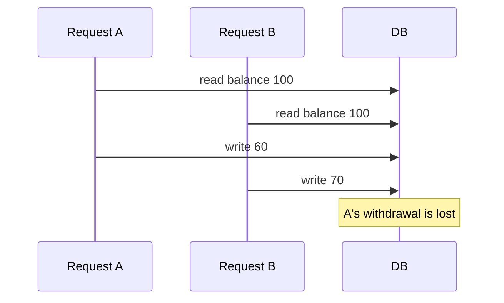

# goodreview-pr-reply

Post a `/goodreview` report to the current branch's pull request as one review: an overview comment, plus an inline comment on the changed line for each finding. The user approves the draft before anything reaches GitHub.

## Arguments

```text
/goodreview-pr-reply [selection prompt]
```

The selection prompt is free text that says which findings to post, such as `blockers only`, `1 and 3`, `skip the test coverage one`, or `only what the second model confirmed`. With no prompt, post every finding.

## Step 1: Find the report and the pull request

The report is the most recent `/goodreview` report in this conversation, or one the user pasted. With no report, stop and tell the user to run `/goodreview [base ref]` first.

Run these as separate shell calls:

```bash
gh pr view --json number,url,headRefOid,baseRefName
gh api user --jq .login
git rev-parse HEAD
git status --porcelain
gh pr diff [number]
gh api "repos/{owner}/{repo}/pulls/[number]/comments" --paginate
```

Stop and tell the user if the branch has no pull request or a command fails.

The report is **stale** when `HEAD` differs from `headRefOid` or the working tree has changes, because `/goodreview` then read code the pull request does not contain. A stale report still posts. Step 3 decides each finding against the pull request's own diff, and the draft in Step 5 says the report is stale.

## Step 2: Select findings

Sort every numbered finding in the report into posted or skipped by applying the selection prompt. Give each skipped finding a reason of a few words. When the prompt does not settle a finding, post it and flag it as undecided in the draft.

Keep the report's finding numbers, so the user can match a comment to the report.

Skip a finding that already has a comment on the pull request from an earlier run: same path, same line, and a body that opens with the attribution callout.

If the prompt selects nothing, stop and list the findings by number and title.

Take the verdict from the posted findings and the report's Evidence section: `Don't ship` for a confirmed Blocker or a check this change broke, `Fix first` for any other finding, `Ship` for none.

## Step 3: Place each finding

A finding gets an inline comment when both hold:

- Its `file:line` is a line on the right side of `gh pr diff`: an added line, or a context line inside a hunk.
- The pull request head has the code the finding describes at that line.

Every other finding goes in the overview, with its failure view and fix below the table. GitHub rejects the whole review when one inline comment names a line outside the diff, so check each line against the hunk ranges.

## Step 4: Draft

Every comment opens with the attribution callout. Use the verified public name of the model writing the comment, or the name of the tool you are running in when it does not expose one. Use the GitHub login from Step 1.

Overview:

````markdown
> [!NOTE]
> 🤖 **[model] responding on behalf of [login]**

**[Ship | Fix first | Don't ship].** [One sentence giving the reason.]

```diff
[finding map]
```

| # | Finding | Severity | Where |
|---|---|---|---|
| [n] | [title] | [Blocker or Should fix] | `[file:line]` |

[For each finding without an inline comment: its number and title, then its failure view and fix.]

## Evidence

- `[command]`: [pass and fail counts]

## Merge danger

**Door:** [one-way or two-way]. [Why.]

**Blast radius:** [one word]. [What a failure could reach.]
````

Inline comment:

````markdown
> [!NOTE]
> 🤖 **[model] responding on behalf of [login]**

**[Blocker or Should fix].** [What breaks, and for whom, in one sentence.]

[failure view]

```suggestion
[replacement for the anchored lines]
```

[Confirmed or Plausible] by [provider]. [For plausible: what the reviewer could not verify.]
````

The **finding map** is the report's What changed sketch with each posted finding's number and severity on the line of the sketch it hits, so the reader sees where the findings land before reading any of them:

```diff
 pay_invoice
   load_invoice
+  charge_card        # 1 Blocker
+  mark_paid          # 3 Should fix
   send_receipt
```

Keep only the lines needed to place the findings. With no posted findings, show the sketch without marks.

The **failure view** is the finding's failure scenario drawn in the smallest form that shows it. Pick one per finding:

- A trace tree when one cause leads to the failure. One step per line, each step nested under the step that causes it:

```text
the client retries POST /invoices/:id/pay
  charge_card runs a second time
    the customer pays twice
```

- A Mermaid sequence diagram when the failure depends on the order of events between two actors, such as a race, a retry, or a redelivered message. GitHub renders Mermaid in comments:



- Pseudocode with the missing case marked when the code handles a branch, boundary, or empty input wrongly:

```text
on(apply_discount)
  if cart is empty      <- not handled, divides by zero
  rate = discount / item_count
```

Put each view directly under the sentence it supports. One failure view and one fix per comment.

Show the fix in the smallest form that fits:

- A `suggestion` block when the fix replaces exactly the lines the comment is anchored to. Anchor the comment to that whole range so the author can apply it in one click.
- A `diff` block when the fix touches other lines or another file.
- One sentence when the fix is longer than a few lines.

Carry the Evidence and Merge danger sections over from the report. With no posted findings, the overview has the verdict line, Evidence, and Merge danger, and the review has no inline comments.

### Writing

The reader is the pull request's author, who knows the change and has not seen the report.

- Start at the conclusion and end at the fix. Greetings, thanks, and sign-offs stay out.
- State a confirmed finding as fact. State a plausible finding as a judgment and name what is unverified.
- Write whole sentences with their articles and verbs. Name the actor: "the retry runs `charge_card` twice".
- Use the plain word: "use", "because", "if".
- Separate clauses with periods and commas.
- Give a number or a named mechanism where the report has one, in place of an adverb.
- Bold only the severity or verdict that opens the comment.
- Cite code as `file:line` and quote identifiers in backticks.

Before the draft is final, read every comment, including quoted code and command output, for secrets, tokens, absolute local paths, and private details, and remove them.

## Step 5: Approve and post

Print the draft in chat:

- The overview as it will render
- Each inline comment under its `path:line`
- The skipped findings with their reasons, and the undecided ones flagged
- A line saying the report is stale, when it is

Ask the user to approve. Apply any edits they ask for and show the changed comments again. Post only after the user approves.

Post one review. Write the payload to a file outside the repository and pass it with `--input`, so comment text never becomes shell syntax:

```bash
gh api --method POST "repos/{owner}/{repo}/pulls/[number]/reviews" --input [payload file]
```

```json
{
  "commit_id": "[headRefOid]",
  "event": "COMMENT",
  "body": "[overview]",
  "comments": [
    {
      "path": "[file]",
      "line": 42,
      "side": "RIGHT",
      "body": "[inline comment]"
    }
  ]
}
```

For a range, add `"start_line"` and `"start_side": "RIGHT"`, with `line` as the last line of the range.

The event is always `COMMENT`. Approving, requesting changes, resolving threads, and pushing fixes stay with the user.

If GitHub rejects the review because of a line, move that finding into the overview and post once more. Done when GitHub returns the review's `html_url`; print it with the count of inline comments posted.

$ARGUMENTS
